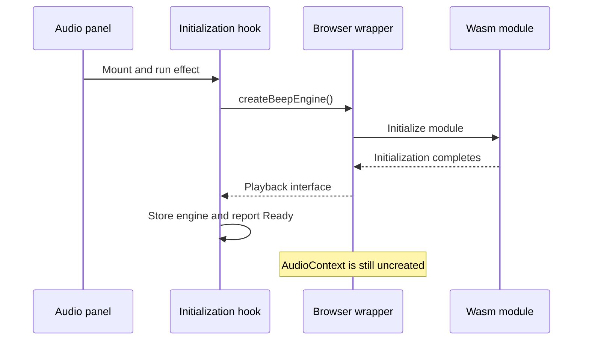
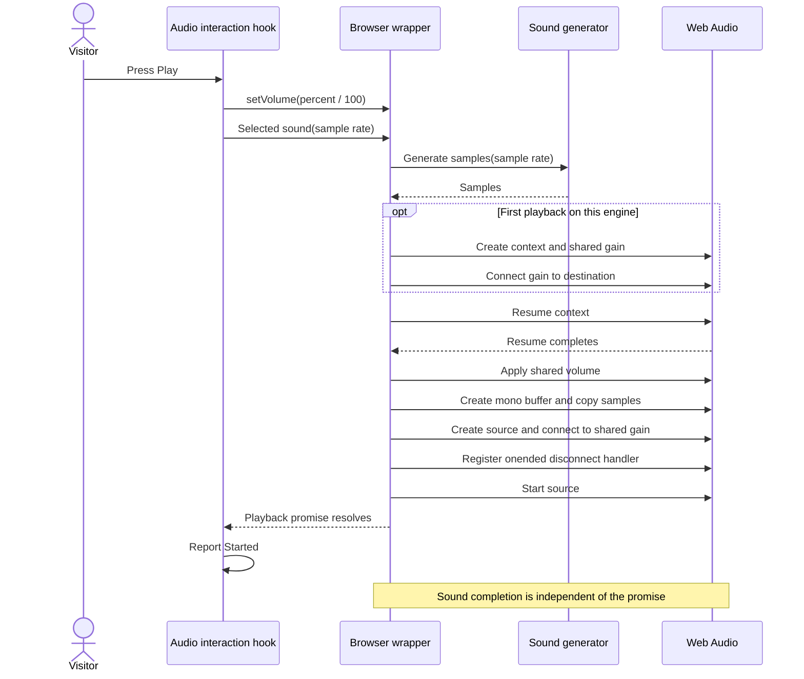

# Bureau of Audible Transit

## A sound's lifecycle — From Play to the browser output

[Documentation reception](README.md) · [Architecture](ARCHITECTURE.md)

**Scope:** the PHW audio-test integration and the browser wrapper shipped in the installed BeepEngine 0.1.2 package. This explanation follows inspected source; it does not claim an acoustic measurement, a new test execution, or a new implementation. Its local documentation route is implemented at `/doc/audio-lifecycle`; Vincent confirms the page is displayed. Vincent confirms the requested local checks and production build. Targeted Biome checks pass, and exported HTML inspection confirms the heading and current-page marker. Foundation commit #89 passed its exact CI and deployment; the later diagram integration is published in 4.4.0 on verified commit #90.

The Bureau is responsible for the journey of exactly two sounds. Its staffing diagram is considerably longer than its repertoire. To understand the journey, follow the responsibilities in order: access, initialization, settings, command dispatch, sample generation, browser playback, and status reporting.

The final section supplies two Mermaid sequence diagrams. The PHW browser renderer is implemented locally; Vincent confirms the requested local checks, production build, and browser diagram checks; [stable 4.4.0](RELEASE-4.4.0.md) is published on commit #90, whose CI and Pages deployment succeeded. The prose explains the sequence independently of diagram support.

## 1. The reception desk precedes the engine

The [audio-test route](../frontend/src/app/audio-test/page.tsx) composes the header and [AudioTestAccess](../frontend/src/features/audio-test/components/AudioTestAccess.tsx). The access component initially presents a password form. On acceptance, its local React state changes and it mounts the spacer and audio panel.

This distinction affects timing: the real page does not mount the panel's audio hooks while it is still displaying the initial access form. The password ceremony therefore precedes normal panel initialization. It is client-side presentation on a static site, not server-enforced protection of confidential resources.

Reloading resets that component state. The Bureau has not issued a durable access credential.

## 2. Wasm loading and browser audio have different arrival times

[AudioTestPanel](../frontend/src/features/audio-test/components/AudioTestPanel.tsx) calls [useAudioTest](../frontend/src/features/audio-test/hooks/useAudioTest.ts), which calls [useBeepEngine](../frontend/src/features/audio-test/hooks/useBeepEngine.ts). The initialization hook begins with a null engine and the status Loading BeepEngine.... Its effect calls createBeepEngine from the package.

In BeepEngine 0.1.2, createBeepEngine first awaits the Wasm initialization function. It then returns a browser playback interface with setVolume, startupBeep, and crashSound. The wrapper initially keeps its AudioContext and shared GainNode uncreated, and its stored volume at one.

This means Ready. in PHW indicates that the engine interface was obtained. It does not mean a context has already been created, that an output device is audible, or that a listener has heard anything. Context creation belongs to the first playback request.

The hook stores the resolved interface and changes status to Ready., or converts an initialization rejection into an Initialization failed message. Its cleanup sets a cancellation flag so a later promise completion will not update the abandoned hook instance. It does not cancel the underlying initialization promise, close an audio context, or dispose of the package's resources.

The Clerk of Readiness certifies receipt of an interface. Requests to certify the visitor's speakers are outside that clerk's jurisdiction.

## 3. The settings office holds intentions, not prerecorded files

The interaction hook starts with three choices:

| Setting | Initial value | Meaning at the PHW boundary |
| --- | --- | --- |
| Sound | startupBeep | Select the startupBeep method rather than crashSound |
| Sample rate | 48,000 Hz | Pass 48000 to the selected engine method |
| Volume | 100 percent | Convert to the engine's normalized value of 1 |

The [Sound type](../frontend/src/features/audio-test/types/Sound.ts) limits the selected method name to startupBeep or crashSound. The sample-rate selector offers 44,100 and 48,000 Hz. These controls update React state; choosing a sound or sample rate does not itself start playback.

The volume callback updates the displayed state and calls engine.setVolume(value / 100) when an engine exists. Before initialization completes, React can retain a volume choice without calling a nonexistent engine. The Play command reapplies the selected volume before dispatching playback, so the initial engine volume need not be the final user choice.

Percent is a UI convention. The package accepts finite values between zero and one and rejects values outside that range. Neither the percentage nor that normalized value is a measured sound-pressure level or a promise of perceived loudness.

## 4. Play is a command with a guarded entrance

[PlaybackControls](../frontend/src/features/audio-test/components/PlaybackControls.tsx) receives isReady and onPlay. Its button is disabled while isReady is false. The hook also returns immediately if play is called without an engine; the disabled button is not the only guard.

Once ready, the command does the following inside its try block:

1. Apply the current volume, converting the percentage to a normalized value.
2. Invoke engine[selectedSound](sampleRate).
3. Await the returned playback promise.
4. Report Started followed by the selected sound and sample rate.

A synchronous exception inside that block or a playback rejection becomes a Playback failed status using the shared [errorMessage helper](../frontend/src/shared/errors/errorMessage.ts). The helper extracts Error.message or converts another thrown value to a string.

There is no playback-in-progress state that disables Play after a successful initialization. The Bureau cannot infer a one-sound-at-a-time policy from the button's ready flag.

## 5. The package supplies samples; Web Audio supplies playback

The inspected browser wrapper imports Wasm-backed startupBeep and crashSound generators. Its internal play function calls the selected generator with the requested sample rate before creating the context if needed. The resulting samples are the material to be played.

On the first playback call, it creates an AudioContext, creates an output GainNode, initializes its gain from stored volume, and connects that gain to context.destination. Later calls on that engine reuse the context and gain.

The wrapper awaits context.resume(), applies its current volume, creates a one-channel AudioBuffer with the sample count and requested sample rate, then copies the samples into channel zero. It creates a fresh AudioBufferSourceNode, attaches the buffer, connects the source to the shared gain, and starts the source.

The signal path is therefore:

**Generated samples → AudioBuffer → fresh buffer source → shared gain → context destination.**

The Wasm generator is not a React component. The gain is not a second generator. The DOM status does not carry audio samples. These distinctions will make the later sequence diagram useful rather than merely ornate.

The package's implementation is inspected under its installed web files, corresponding to the [vendored 0.1.2 archive](../frontend/vendor/beep-engine-0.1.2.tgz). Its separately maintained Rust source is outside this application's source tree. This page describes the browser integration boundary without inventing details of the synthesis algorithm.

## 6. Started is not Finished

The wrapper calls source.start() and finishes its asynchronous function. It does not wait for the source's ended event before resolving the promise. PHW's Started status therefore corresponds to completion of the start request, not completion of the audible sound.

Each source receives an onended callback that disconnects that source. This cleanup is separate from resolving the playback promise. The shared gain and context remain available for subsequent requests; the exposed interface does not provide a close or stop method.

Success also does not prove that sound reached a listener. A zero volume, device settings, and the listening environment are outside the meaning of that status. An asynchronous device problem after the wrapper has resolved is not automatically a rejection of the already completed promise.

The Department of Completed Performances is instructed not to stamp a departure notice with the arrival time.

## 7. Volume belongs to the shared output

The package stores volume even before a gain node exists. Once the shared gain exists, setVolume changes that node's gain value, so the control can affect sounds already playing through it. Before each new source starts, the wrapper applies the currently stored volume again.

A new buffer source is created for each playback request. The wrapper does not stop earlier sources when another starts, and PHW does not impose a busy lock. Multiple requests can therefore overlap; they pass through the same output gain for that engine instance.

Selecting another sound or sample rate governs a later request. It does not replace a buffer that has already been started. The current status describes a command result, not a complete list of simultaneously active sources.

These are source-level properties of the inspected version, not a recommendation to stress the interface or a claim that every overlapping case has been tested.

## 8. What the current tests actually witness

The [audio-page suite](../frontend/src/app/audio-test/page.test.tsx) mocks BeepEngine and substitutes AudioTestPanel for AudioTestAccess. It exercises the panel integration without executing the real password gate, Wasm generation, AudioContext, or physical output.

Its cases check pending initialization, readiness and defaults, initialization failures, selected sound and sample-rate dispatch, playback failure reporting, and volume conversion on change and playback. Those checks are valuable precisely because their boundary is clear.

They do not establish real acoustic output, completion timing, password acceptance, resource disposal, or observed overlap behavior in a browser. Reading the package source explains those paths; it is a different kind of evidence from executing them.

## 9. Read the journey yourself

Start with the panel and identify which hook supplies its values and callbacks. Follow play in useAudioTest, then compare its awaited call with the installed package's internal play function. Locate source.start(), the promise's completion, and source.onended as three related but distinct events.

Next, follow a volume change before initialization and after the first playback. Finally, read the test mocks before their assertions. This order separates what PHW coordinates, what the package supplies, what the browser executes, and what the test suite substitutes.

The diagrams below separate initialization from playback, preserve lazy context creation, and avoid placing Started after sound completion. These are the questions their rendering must continue to answer.

The Bureau has written the itinerary and is preparing its first diagram projector for inspection.
## 10. The projector's first programme

The two diagrams below describe the successful path. Initialization failures and playback failures are explained in the preceding sections. Separate diagrams keep engine readiness distinct from an individual playback request. The prose remains the complete explanation when a diagram cannot be rendered.

**Renderer status:** the PHW website now recognizes these Mermaid blocks and renders them in the browser with the selected documentation theme. Source inspection and targeted Biome checks pass. Vincent confirms the requested browser checks and production build; [stable 4.4.0](RELEASE-4.4.0.md) is published on commit #90, whose CI and Pages deployment succeeded. The source disclosure and prose remain available independently of SVG rendering.

### Engine readiness

### One playback request

The onended handler disconnects its source when playback finishes; it is not the awaited completion of the engine method. The diagram deliberately does not assign a duration to the sound or certify when the visitor hears it. The lazy initialization branch concerns this engine's first playback, not every press of Play.

The Bureau now has a programme and a locally implemented projector. Local checks and exact-commit CI are confirmed, and stable 4.4.0 is published.
